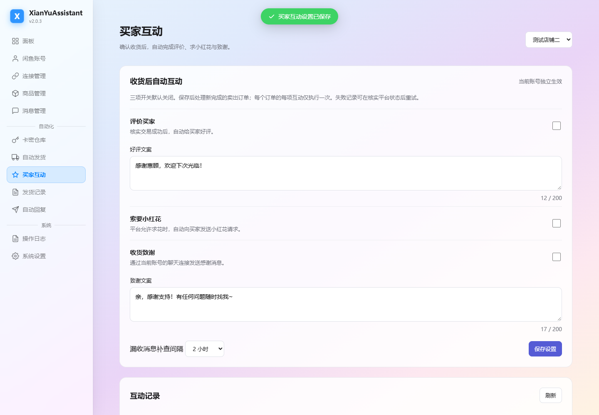

# 多规格发货与买家互动

本次参照用户提供的 xianyu-super-butler 功能设计，在现有 Java / Vue 项目中实现。项目地址：https://github.com/23Star/xianyu-super-butler

## 多规格发货

1. 在「商品管理」同步商品和规格，在「卡密仓库」创建当前闲鱼账号的卡密仓库并导入库存。
2. 打开「自动发货」，选择账号、商品、具体规格。每个规格独立选择文本发货或卡密发货并保存。
3. 卡密发货文案使用 `{kmKey}` 占位符。规格标签显示「已配置 / 未配置」。
4. 开启商品自动发货；需要自动确认已发货时，开启页面顶部的「自动确认发货」。

- 已建立任何规格配置的商品，必须精确匹配订单 SKU。未知规格或未配置规格会记录失败原因，不套用商品默认内容。
- SKU 优先使用平台订单的 SKU ID，缺少 ID 时按规格文本匹配；支持中文冒号、分号与维度顺序变化，存在歧义时停止发货。
- 在线聊天、离线凭证发货和待发货订单轮询共用规格选择和整单预留逻辑。
- 按购买数量发出对应份数；数量缺失、非法或超过 100 件时停止并提示人工核实。
- 整单库存不足时回滚本次取卡。内容预留成功后保存到订单；发送失败再次重试时使用原卡密和已确认的发送进度。
- 平台离线凭证最多 200 字。整单内容超限时停止并提示连接 WebSocket 后重试，防止卡密被截断。部分聊天发货后需要恢复聊天连接继续。
- 已成功订单跳过再次触发；同一订单的消息、轮询和手动触发串行处理。

## 买家互动

左侧「自动化 → 买家互动」，按账号分别配置并保存：

- **评价买家**：交易成功后自动提交好评，可自定义 200 字内文案。
- **索要小红花**：平台出现可执行的求花操作时发送请求。
- **收货致谢**：使用聊天连接发送自定义致谢文案，需要买家会话和 WebSocket 连接。

所有开关默认关闭。收货系统消息触发持久化任务；评价和求花延迟约 20 秒，等待平台状态流转。后台每 5 秒检查待执行任务，每项执行前重新读取账号开关并核实卖家已完成订单。

漏收消息时按配置间隔补查新完成的订单（默认 2 小时，可选 5 分钟到 24 小时）。补查每轮最多检查 10 页、每页 50 单；只处理本轮启用后完成且平台提供完成时间的订单。事件缺少订单号时，会结合平台买家与本地会话匹配。更早的历史订单不会因为首次开启而批量发送互动。

互动记录按「账号 + 订单 + 互动类型」唯一保存。成功、等待、跳过和失败状态可查询；重启后继续处理待执行任务。等待状态最多检查 20 次，间隔 30 秒。写操作失败或执行中断且结果未知时记录为失败，先核实平台状态，再点击该记录的「重试」。

## 运行与升级

- 构建产物：`target/XianYuAssistant-2.0.3.jar`（内含编译后的前端）。
- Windows 可双击项目根目录 `start-windows.cmd` 启动，浏览器访问 `http://localhost:12400`。
- 首次启动会自动创建互动表，并为原订单表补充预留内容和发送进度字段。无需手动执行 SQL；保留原来的数据库目录即可。
- 新增两张表：`xianyu_buyer_interaction_config`、`xianyu_buyer_interaction_record`。
- 原订单表新增 `delivery_payload`、`delivered_count`。

## 验证

已完成 37 项后端测试：规格选择、文本匹配、跨账号隔离、整单库存回滚、预留内容复用、订单数量解析、互动独立开关、平台完成状态校验、重复任务去重、数据库升级等。

前端通过 Vue TypeScript 类型检查与 Vite 生产构建；使用独立 SQLite 测试库完成应用启动、认证、配置保存、参数校验、账号隔离、分规格保存及桌面/手机页面检查，浏览器无运行错误。

未接入真实闲鱼账号进行真实交易发货、评价或求花。实际平台接口仍需使用有效 Cookie 与真实订单验证。
